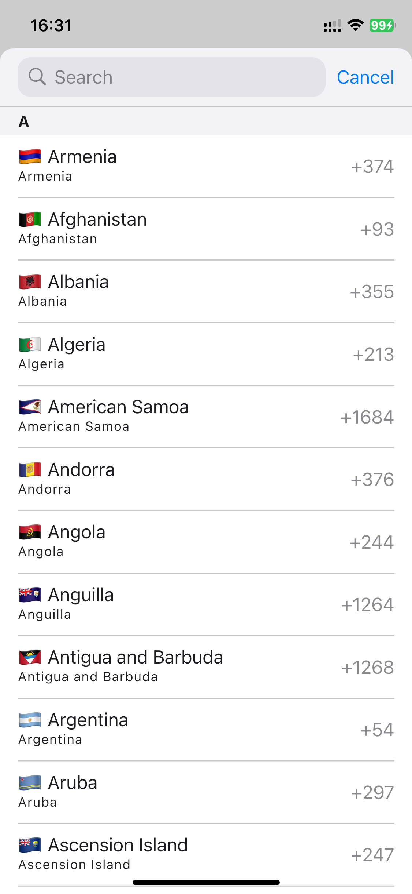
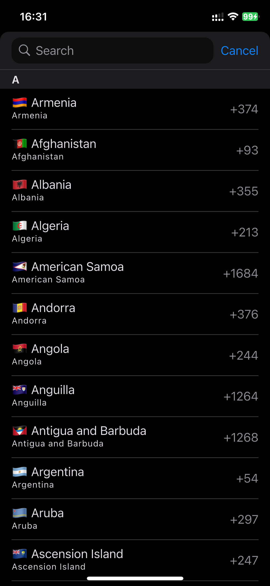
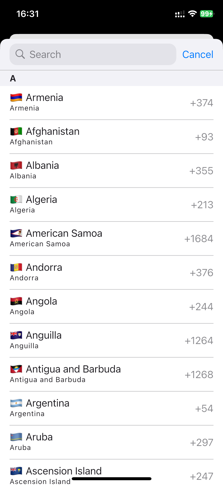
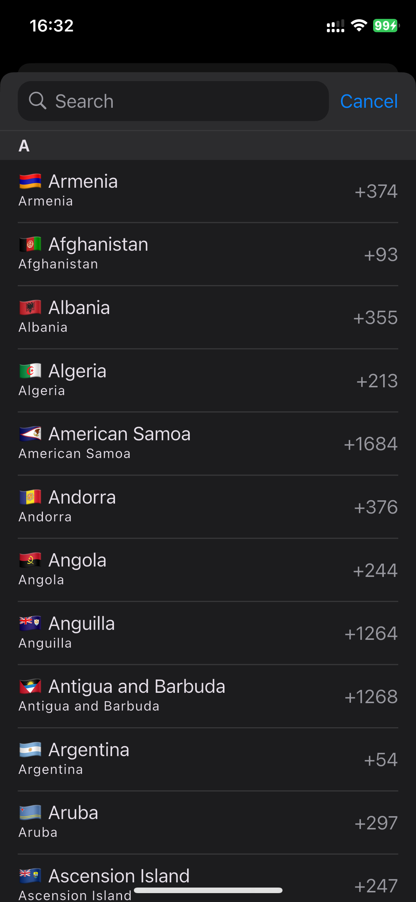
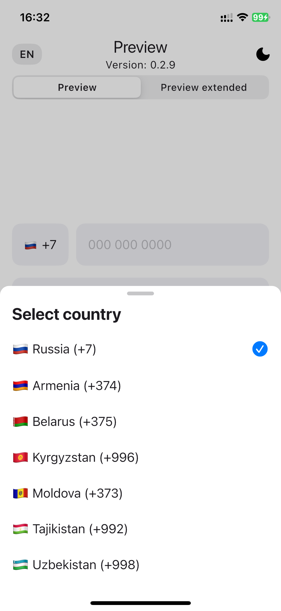
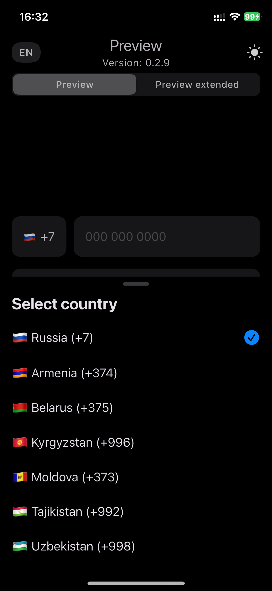
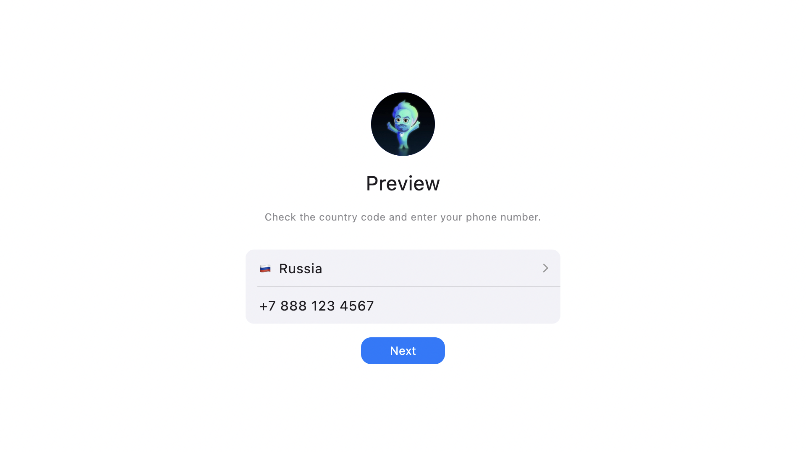
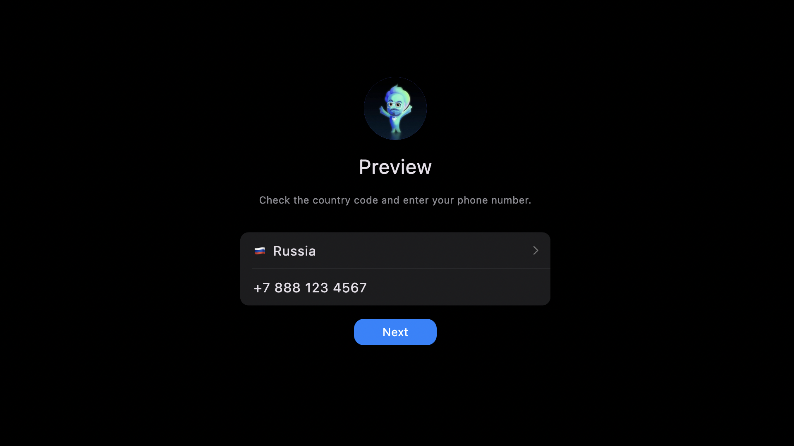
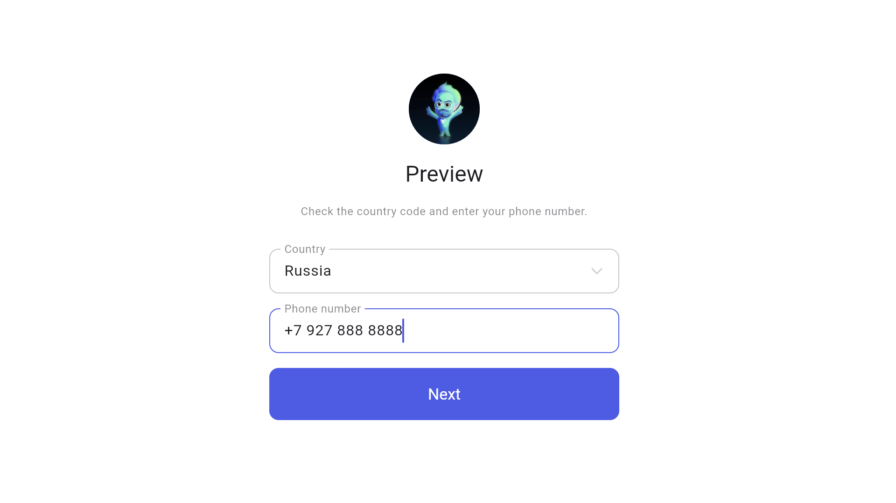
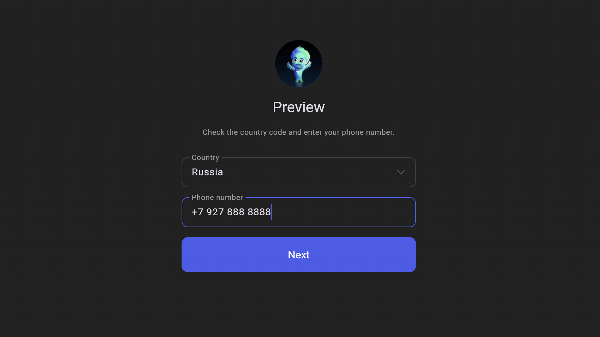

# flutter_simple_country_picker


[](https://pub.dev/packages/flutter_simple_country_picker)
[](https://pub.dev/packages/flutter_simple_country_picker)
[](https://github.com/ziqq/flutter_simple_country_picker/actions/workflows/checkout.yml)
[](https://codecov.io/gh/ziqq/flutter_simple_country_picker)
[](https://opensource.org/licenses/MIT)
[](https://pub.dev/packages/flutter_lints)
<!-- [](https://pub.dev/packages/flutter_simple_country_picker) -->
<!-- [](https://github.com/ziqq/flutter_simple_country_picker/) -->


     







## Description

An easy-to-use country selection widget for Flutter. Allows users to select a country from a comprehensive list. Supports **Android**, **iOS**, **macOS**, **Web**, **Windows** and **Linux** platforms. Includes a phone-number input widget with automatic mask formatting, adaptive bottom sheet, theme customization, and 35+ locales.


## Quick Start

Add the package and register the localization delegate, then open the picker:

```dart
import 'package:flutter/material.dart';
import 'package:flutter_localizations/flutter_localizations.dart';
import 'package:flutter_simple_country_picker/flutter_simple_country_picker.dart';

MaterialApp(
  localizationsDelegates: [
    CountryLocalizations.delegate,
    GlobalWidgetsLocalizations.delegate,
    GlobalMaterialLocalizations.delegate,
    GlobalCupertinoLocalizations.delegate,
  ],
  // Pass the built-in list directly — no need to enumerate locales manually.
  supportedLocales: CountryLocalizations.supportedLocales,
  home: const MyHomePage(),
);

// Inside your widget:
showCountryPicker(
  context: context,
  onSelect: (Country country) {
    print(country.displayName); // e.g. “Russia (+7)”
  },
);
```


## Getting Started

Add the package to your `pubspec.yaml`:

```yaml
flutter_simple_country_picker: ^latest
```

Import the library in your Dart file:

```dart
import 'package:flutter_simple_country_picker/flutter_simple_country_picker.dart';
```

### Resolve Country from Locale

Use `fromLocale` or `fromLocaleOrNull` when you need a
bundled country from a `Locale` or region code.

```dart
final us = Country.fromLocale(const Locale('en', 'US'));
print(us.displayName); // United States (US) [+1]

final sh = Country.fromLocaleOrNull(const Locale('en', 'AC'));
print(sh?.countryCode); // SH

final es = Country.fromCountryCode('IC');
print(es.countryCode); // ES
```

Alias normalization is built in. Region codes such as `AC`, `IC`, and `TA`
resolve to the ISO2 codes present in the bundled dataset.


## Setup Localizations

Add `CountryLocalizations.delegate` to your app's `localizationsDelegates` and list the locales you want to support.

```dart
MaterialApp(
  locale: const Locale('en'),
  supportedLocales: const <Locale>[
    Locale('en'),
    Locale('ru'),
  ],
  localizationsDelegates: [
    CountryLocalizations.delegate,
    GlobalWidgetsLocalizations.delegate,
    GlobalMaterialLocalizations.delegate,
    GlobalCupertinoLocalizations.delegate,
  ],
  home: const HomePage(),
);
```

> **Tip:** pass `CountryLocalizations.supportedLocales` to `supportedLocales` to
> enable all 36 built-in locales at once.

Supported locales: `ar`, `bg`, `ca`, `cs`, `da`, `de`, `el`, `en`, `es`, `et`,
`fa`, `fr`, `he`, `hi`, `hr`, `ht`, `id`, `it`, `ja`, `ko`, `ku`, `lt`, `lv`,
`nb`, `ne`, `nl`, `nn`, `pl`, `pt`, `ro`, `ru`, `sk`, `tr`, `uk`,
`zh-Hans` (Simplified Chinese), `zh-Hant` (Traditional Chinese).

### Custom localizations

`CountryLocalizations` is an `abstract class`. You can extend it to add a new language or override existing strings without forking the package:

```dart
final class CountryLocalizationsMyLang extends CountryLocalizations {
  const CountryLocalizationsMyLang();

  @override
  String get cancelButton => 'Cancel';

  @override
  String get phonePlaceholder => 'Phone number';

  @override
  String get searchPlaceholder => 'Search country';

  @override
  String get selectCountryLabel => 'Select country';

  @override
  String? countryName(String countryCode) => _names[countryCode];
}

const Map<String, String> _names = {
  'US': 'United States',
  'RU': 'Russia',
  // …
};
```

Register it in the delegate by creating your own `LocalizationsDelegate<CountryLocalizations>` that returns your subclass for the desired locale, or contribute it back to the package.


## Usage

## Migration

Upgrade notes are documented in [MIGRATION.md](MIGRATION.md).

- `0.12.0`: [Migrate to 0.12.0](MIGRATION.md#to-0120)
- `0.11.1`: [Migrate to 0.11.1](MIGRATION.md#to-0111)
- `0.10.0`: [Migrate to 0.10.0](MIGRATION.md#to-0100)
- `0.9.0`: [Migrate to 0.9.0](MIGRATION.md#to-090)

### showCountryPicker

Opens a bottom sheet with a scrollable/searchable country list.

```dart
showCountryPicker(
  context: context,
  exclude: const ['RU'],
  favorites: const ['US', 'GB'],
  onSelect: (Country country) {
    debugPrint('Selected: ${country.displayName}');
  },
  whenComplete: () {
    debugPrint('Picker dismissed');
  },
);
```

#### Parameters

| Parameter              | Type                    | Default | Description                                                                         |
|------------------------|-------------------------|---------|-------------------------------------------------------------------------------------|
| `context`              | `BuildContext`          | —       | **Required.** Build context.                                                        |
| `onSelect`             | `SelectCountryCallback?`| `null`  | Called when a country is selected.                                                  |
| `whenComplete`         | `VoidCallback?`         | `null`  | Called when the picker is dismissed, regardless of selection.                       |
| `exclude`              | `List<String>?`         | `null`  | ISO2 codes of countries to exclude.                                                 |
| `favorites`            | `List<String>?`         | `null`  | ISO2 codes of countries to pin at the top.                                          |
| `filter`               | `List<String>?`         | `null`  | ISO2 codes to show exclusively. Cannot be combined with `exclude`.                  |
| `selected`             | `SelectedCountry?`      | `null`  | Notifier holding the pre-selected country.                                          |
| `expand`               | `bool`                  | `false` | Expand the bottom sheet to full height.                                             |
| `adaptive`             | `bool`                  | `false` | Uses a Cupertino-style modal on iOS.                                                |
| `autofocus`            | `bool`                  | `false` | Automatically focuses the search field.                                             |
| `isDismissible`        | `bool`                  | `true`  | Whether the sheet can be dismissed by tapping the barrier.                          |
| `isScrollControlled`   | `bool`                  | `true`  | Controls scroll behavior of the modal.                                              |
| `shouldCloseOnSwipeDown`| `bool`                 | `false` | Closes the sheet on swipe-down gesture.                                             |
| `showPhoneCode`        | `bool`                  | `false` | Displays the country phone code in the list.                                        |
| `showWorldWide`        | `bool`                  | `false` | Shows a "World Wide" entry at the top.                                              |
| `showGroup`            | `bool?`                 | `null`  | Groups countries by their first letter.                                             |
| `showSearch`           | `bool?`                 | `null`  | Shows or hides the search bar.                                                      |
| `useHapticFeedback`    | `bool`                  | `true`  | Enables haptic feedback on opening and selection.                                   |
| `useRootNavigator`     | `bool`                  | `true`  | Uses the root navigator to display the sheet above all other routes.                |
| `useSafeArea`          | `bool`                  | `true`  | Wraps the sheet in a `SafeArea`.                                                    |
| `initialChildSize`     | `double?`               | `null`  | Initial fractional height of the draggable sheet.                                   |
| `minChildSize`         | `double?`               | `null`  | Minimum fractional height of the draggable sheet.                                   |


### CountryPhoneInput

A ready-made phone-number text field with an embedded country flag/code selector and automatic mask formatting.

```dart
CountryPhoneInput(
  initialCountry: Country.ru(),
  placeholder: 'Phone number',
  showPhoneCode: true,
  onChanged: (String value) {
    debugPrint('Phone: $value');
  },
  onCountryChanged: (Country country) {
    debugPrint('Country: ${country.displayName}');
  },
);
```

Use `CountryPhoneInput.extended` for additional layout and presentation configuration such as custom scroll sizes. The extended variant also uses a single resolved picker text style consistently across the country label, code, input, cursor, and hint text.

Set `enableOpenPicker: false` when the selected country should stay visible in
the prefix button but the picker must not open on tap:

```dart
CountryPhoneInput(
  initialCountry: Country.us(),
  enableOpenPicker: false,
  showPhoneCode: true,
)
```

### CountryPhoneController

A concrete `ValueNotifier<CountryPhoneEditingValue>` that manages phone input
state and exposes the raw text, normalized phone, calling code, national
number, dataset-based resolution, and input-length status.

```dart
// Create with an initial value
final controller = CountryPhoneController.apply('+7 123 456 78 90');

print(controller.text);        // +7 123 456 78 90
print(controller.phone);       // +71234567890
print(controller.number);      // 1234567890
print(controller.resolution.status); // CountryPhoneResolutionStatus.exact
print(controller.resolution.primaryCountryCode); // RU
print(controller.resolution.countryCodes); // [RU]
print(controller.resolution.isAmbiguous); // false
print(controller.valueStatus.currentLength); // 10
print(controller.valueStatus.isIncomplete); // false
print(controller.value.phone); // +71234567890

// Or start empty
final emptyController = CountryPhoneController.empty();

// Or seed the full editing value explicitly
final seededController = CountryPhoneController.fromValue(
  CountryPhoneEditingValue(
    text: '+44 7911 123456',
    valueStatus: const CountryPhoneValueStatus(
      currentLength: 10,
      expectedLength: 10,
      isOverflow: false,
    ),
  ),
);
```

Dispose controllers you create yourself:

```dart
final controller = CountryPhoneController.empty();

@override
void dispose() {
  controller.dispose();
  super.dispose();
}
```

Resolution is dataset-based. The controller compares the parsed national number
with bundled example numbers and then uses dataset priority to keep ordering
stable when multiple candidates remain.

This is not a full metadata validator like `libphonenumber`. If you need strict
carrier- or region-level validation, treat `resolution` as a lightweight
bundled heuristic and validate the final number separately.

There is no direct ISO2 getter anymore. Read the primary candidate from
`resolution.primaryCountryCode` and inspect `resolution.status` before assuming
the result is exact.

Pass the controller to `CountryPhoneInput` and observe the whole value:

```dart
ValueListenableBuilder<CountryPhoneEditingValue>(
  valueListenable: controller,
  builder: (context, value, _) {
    final status = value.valueStatus;

    return Column(
      children: [
        CountryPhoneInput(controller: controller),
        Text(
          'digits: ${status.currentLength}/${status.expectedLength}, '
          'complete: ${status.isComplete}, overflow: ${status.isOverflow}, '
          'phone: ${value.phone}',
        ),
      ],
    );
  },
)
```

External updates should go through the immutable value API:

```dart
controller.value = controller.value.copyWith(
  text: '+44 7911 12345',
);

controller.value = controller.value.copyWith(
  valueStatus: controller.valueStatus.copyWith(expectedLength: 10),
);
```

End-to-end example:

```dart
final controller = CountryPhoneController.empty();

CountryPhoneInput(
  controller: controller,
  initialCountry: Country.us(),
  showPhoneCode: true,
  onChanged: (_) {
    switch (controller.resolution.status) {
      case CountryPhoneResolutionStatus.exact:
        debugPrint('ISO2: ${controller.resolution.primaryCountryCode}');
      case CountryPhoneResolutionStatus.ambiguous:
        debugPrint('Candidates: ${controller.resolution.countryCodes}');
      case CountryPhoneResolutionStatus.unresolved:
        debugPrint('No bundled match for ${controller.phone}');
    }
  },
);
```


### CountryInputFormatter

A `TextInputFormatter` that formats input according to a phone mask. Supports `lazy` (default) and `eager` completion modes. When the input exceeds the mask length, the formatter switches to flat mode (digits only). Read `valueStatus` when you need the current formatted-length state.

```dart
final formatter = CountryInputFormatter(
  mask: '000 000-00-00',
);

debugPrint('${formatter.valueStatus.currentLength}/${formatter.valueStatus.expectedLength}');
```

| Symbol | Matches       |
|--------|---------------|
| `0`    | digit `[0-9]` |
| `#`    | digit `[0-9]` |
| `A`    | digit `[0-9]` |

For automatic country and prefix rules with a soft tail, opt in explicitly:

```dart
CountryPhoneInput(
  initialCountry: Country.fromCountryCode('ID'),
  useCountryFormatting: true,
);

final formatter = CountryInputFormatter.forCountry(
  country: Country.fromCountryCode('ID'),
  shouldTryStripLeadingPrefix: true,
);
```

The extended input accepts the same option. Automatic formatting chooses a
country/prefix pattern and preserves all digits beyond its capacity, including
separators. For Indonesian mobile inputs, all supported lengths from 9 to 12
digits can be complete. `expectedLength` is the next supported length at or
above the current input, or the maximum for overflow. This describes length,
not assignment, reachability or SMS support. Both selection endpoints follow
digit positions; active IME composition is left untouched until commit.

The regular formatter constructors and the default input mode retain manual
mask behavior, including custom filters and `mask: null`. `updateMask` selects
manual formatting; `updateCountry` selects automatic rules. The bundled rules
cover 238 countries. HM, GS and VA retain the bundled mask as a soft fallback;
number-prefix transforms that add or rewrite digits are not implemented.
Metadata comes from pinned Apache-2.0 libphonenumber data; generation is in
`tool/generate_phone_rules.dart`, with attribution under `assets/licenses/`.
Run `mise exec -- dart run tool/generate_phone_rules.dart` to regenerate, or
add `--metadata /path/PhoneNumberMetadata.xml --check` for an offline check.
The generator verifies the pinned XML SHA-256 and runs the pinned Dart formatter
before writing or comparing the output.


## Gotchas

- `CountryPhoneController.resolution` is dataset-based, not full phone-number
  validation.
- `resolution.primaryCountryCode` can be `null` when the input is unresolved.
- Shared calling codes such as `+1`, `+7`, and `+44` can legitimately produce
  multiple candidates.
- `filter` and `exclude` should not be used together in `showCountryPicker`.
- Manual `CountryInputFormatter` switches to flat mode when input exceeds the mask;
  automatic country formatting keeps the soft tail instead.
- `mask` describes the national number only. It should not include the calling
  code.


### CountryScope

An `InheritedWidget` that pre-loads and provides the country list to its subtree, avoiding repeated async loading.

```dart
CountryScope(
  exclude: const ['RU'],
  child: MyApp(),
)
```

Access from descendants:

```dart
// Get the controller
final controller = CountryScope.of(context);

// Get the list of countries (subscribes to changes)
final countries = CountryScope.countriesOf(context);

// Look up a country by ISO2 code
final country = CountryScope.getCountryByCode(context, 'US');
```

Set `lazy: true` to defer the country-list load until you trigger it
explicitly — useful when the list is only needed behind a navigation gate:

```dart
CountryScope(
  lazy: true,
  child: Builder(
    builder: (context) {
      // Loading starts here, not on CountryScope creation.
      CountryScope.of(context).getCountries();
      return const MyCountryPage();
    },
  ),
)
```


### CountryPickerTheme

A `ThemeExtension` for full visual customization. Register it in your `MaterialApp` theme:

```dart
MaterialApp(
  theme: ThemeData(
    extensions: [
      CountryPickerTheme(
        backgroundColor: Colors.white,
        onBackgroundColor: Colors.black87,
        secondaryBackgroundColor: Colors.grey.shade100,
        onSecondaryBackgroundColor: Colors.black54,
        accentColor: Colors.blue,
        barrierColor: Colors.black54,
        dividerColor: Colors.grey.shade300,
        textStyle: const TextStyle(fontSize: 16),
        secondaryTextStyle: const TextStyle(fontSize: 13),
        searchTextStyle: const TextStyle(fontSize: 14),
        flagSize: 22,
        inputHeight: 56,
        padding: 16,
        baseCornerRadius: 12,
      ),
    ],
  ),
);
```

#### Country picker appearance

The package uses one interface: compact native emoji flags beside localized country names, English subtitles and trailing phone codes. Enable `showGroup: true` for scrolling letter headers and alphabet navigation. In light mode, white rounded groups have equal horizontal theme padding on the secondary background; dark mode keeps a continuous dark list. A transparent, compact `CupertinoNavigationBar` floats above the list, with progressive blur and a soft shade tail adapted from `tetradka_app`'s `UIScrollEdgeEffect`. Renderers without shader-filter support retain the shade. A floating search field and round glass close button sit above the keyboard; another close button appears beside the title. A checkmark marks the selected row.

`CountryPickerStyle` and `CountryPickerTheme.style` have been removed. Remove `style:` from existing theme configuration; the new interface is always used.

Sheet corners use superellipse geometry with a default radius of 38 logical pixels, matching the native UIKit sheet measured on iOS 26.5. Override it through the theme independently of phone input corners:

```dart
CountryPickerTheme(sheetCornerRadius: 24, baseCornerRadius: 12)
```

`radius` is deprecated; use `baseCornerRadius` instead. If both are supplied, `baseCornerRadius` takes precedence.

`sheetCornerRadius` also applies to adaptive Cupertino presentation, including smaller and square corners. Phone inputs retain their default `baseCornerRadius: 12`. At the default `padding: 16`, the header close button has 16 logical pixels above and beside it, with 8 below the navigation bar.

Leave the colors unset to let the list resolve them from the ambient Cupertino theme, with a black list background in dark mode.

Pickers open at full available height by default. Set `expand: false` for a partial nonadaptive sheet; scrolling the list or focusing search then expands it. Search results hide the alphabet index and letter headers; dragging the list dismisses the keyboard. The default close-button treatment is adapted from `tetradka_app`'s `UILiquidGlass$Fake`, using Flutter backdrop blur and press feedback without an app dependency. Reduced motion disables this feedback and high contrast uses opaque close buttons.

With `shouldCloseOnSwipeDown: true`, a gesture started inside the scrolled list returns it to the beginning without dismissing the sheet, including during inertia. A new downward gesture started at the beginning can dismiss it. Tapping the compact app bar or the native iOS status bar scrolls the list to the beginning.

The search field shares the close buttons' press and hover feedback while retaining native text editing, selection and focus. A custom `surfaceBuilder` can observe these search presses through `CountryPickerSurface.pressed`.

The bottom search gap uses the bottom safe area when it is nonzero; otherwise it uses `padding / 2`. Horizontal insets are `padding * 0.75`. The controls are at least 44 logical pixels high and grow with text scaling.

List spacing is the same on Android and iOS: light group surfaces have `padding`
outside and inside, while dark rows use `padding * 2`. With the default theme,
these are 16 + 16 logical pixels. Alphabet glyphs are centered in the outer
padding, with a wider hit target for dragging. The header close button has
`padding` above and beside it and `padding / 2` below the navigation bar.

Pass `shouldCloseOnSwipeDown: true` to enable dragging the sheet down to dismiss it, including a downward drag from the beginning of the country list. The grouped example enables this option. Stock controls take their fill, outline and foreground colors from `CountryPickerTheme`, with the ambient Material theme as a fallback.

To paint your own surfaces behind the search field and the close button (for example a shader-based liquid glass), pass a `surfaceBuilder` to `showCountryPicker`, `CountryPhoneInput` or `CountryPhoneInput.extended`, like `TextField.contextMenuBuilder`. It receives the control content without the background; taps and accessibility stay handled by the picker.

```dart
Widget glassSurface(
  BuildContext context,
  CountryPickerSurface surface,
  Widget child,
) => GlassWidget(
  shape: surface.shape,
  pressed: surface.pressed, // ValueListenable<bool> for press animations
  child: child,
);

showCountryPicker(context: context, surfaceBuilder: glassSurface);
```


## Flags on Windows

The Windows emoji font has no country flags, so a flag emoji is shown as two
letters there. On Windows the package loads a bundled flags-only font
(about 180 KB). It is declared as a Windows-only asset, so iOS, Android,
macOS, Linux and web builds do not include it. The package requires Flutter
3.44 or newer for its Cupertino sheet API.

The font is applied only to flag text, so custom package fonts and their
fallbacks remain in use for country names and phone codes. The bundled
font's license notices are included in Flutter's application license list.

## All Countries List

See the [All Countries List](https://github.com/ziqq/flutter_simple_country_picker/wiki/All-Countries-list) on the wiki.


## Maintainer Notes

For bundled dataset maintenance, shared calling-code caveats, and a copy-paste
template for new entries, see [docs/country-codes.md](docs/country-codes.md).


## Changelog

See [CHANGELOG.md](https://github.com/ziqq/flutter_simple_country_picker/blob/main/CHANGELOG.md) for all release notes.


## Maintainers

[Anton Ustinoff (ziqq)](https://github.com/ziqq)


## Funding

If you want to support the development of this library:
- [Buy me a coffee](https://www.buymeacoffee.com/ziqq)
- [Subscribe through Boosty](https://boosty.to/ziqq)


## License

[MIT](https://github.com/ziqq/flutter_simple_country_picker/blob/main/LICENSE)

Flags on Windows use the bundled "Twemoji Country Flags" font from
[country-flag-emoji-polyfill](https://github.com/talkjs/country-flag-emoji-polyfill) (MIT).
The flag artwork comes from [Twemoji](https://github.com/jdecked/twemoji) and is licensed under
[CC-BY 4.0](https://creativecommons.org/licenses/by/4.0/). See
[assets/fonts/TwemojiCountryFlags.LICENSE.md](assets/fonts/TwemojiCountryFlags.LICENSE.md).


## Coverage


