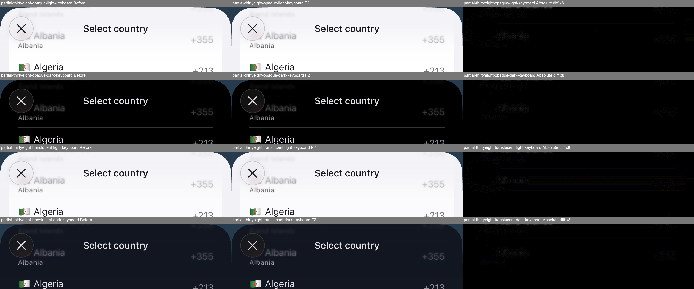

# Picker raster follow-up — 6 November 2026

No runtime optimization from this report is shipped. The PR baseline is `4fc727e`. A8 cache hints are rejected; F2 on 7 Plus is rejected because first opening regresses. The 9 November follow-up below records subsequent F3 and A8 checks.

## Matched inputs

Before source: `72eb8c326764b58ebeae7a813770236310708d38387a8793b0e4ef1a6f86a1b7`. Flutter 3.47.5 / Dart 3.13.4, stock renderer settings, unchanged v3 native-waits fixture and driver. APK engine/embedding and compiler hashes match across A8 variants. The iOS pair uses the same signed Runner/Flutter engine and Xcode 27.2. No warmup, cache purge or device-setting changes.

One fresh install/process per run; OS/driver caches remain. Each run measures first opening and three reopen/drag/fling/keyboard/search/close repetitions. Timings cover the light theme; dark captures check appearance. FrameTiming values are engine wall times, not GPU duration or presented FPS. Small first-opening samples make p95 effectively a peak.

## A8

Raster p95 in milliseconds. B1–B3 are the identical current shipping APK, not historical layouts.

|Run|First|Reopen|Drag|Fling down|Fling up|Keyboard|Search|Close|
|---|---:|---:|---:|---:|---:|---:|---:|---:|
|B1|391.353|27.334|24.319|25.351|22.993|25.825|20.744|32.806|
|Shade cache hint|531.221|26.273|24.192|25.284|24.134|23.070|20.333|32.087|
|B2 reverse control|378.249|24.473|21.754|26.059|23.544|23.694|19.839|35.401|
|B3 new matched temperature|410.579|25.352|26.168|28.626|22.108|23.735|21.122|34.881|
|Row cache hint|383.799|25.508|24.344|25.433|21.935|24.913|21.361|33.842|
|No control blur — diagnostic only|314.837|19.899|17.091|15.953|13.505|12.016|10.741|20.462|

The shade hint (`PictureLayer.isComplexHint`) adds an intermediate raster-cache image. It provides no consistent warm improvement and has the worst first-opening peak. Native rows, flags and dock match exactly, but the header differs by up to 1/255. Rejected.

The row hint marks existing lazy-entry repaint-boundary pictures as complex, without changing painting commands. The cache engages: post-timing engine RPC samples report 8,279,928 and 8,990,832 picture bytes, with zero layer bytes. These are resident samples, not a peak. The small timing differences do not establish a durable win; row/flag pixels also differ by up to 1/255. Rejected.

The synchronous post-timing memory probes delayed the row-hint screenshot collector. In particular its `keyboard-light.png` was captured after keyboard dismissal. All raw differences are retained; keyboard/dock quality for that run is **unqualified**, not a visual acceptance. Its timing windows finish before the probes and are unchanged. Later runners disable these probes by default.

The no-blur variant disables only the three stock control Gaussian backdrops as an ablation. It intentionally changes appearance and is **not a proposed package change**. Warm raster falls substantially, while a roughly 315 ms first peak remains. This supports further investigation of blur cost; it does not identify one GL program or prove an additive cost decomposition.

A diagnostic attempt stopped before installation/timing because the cooled phone no longer matched the earlier reference within 0.5°C. Its failure and cleanup receipt are retained. B3 establishes a new reference; no artificial warming or settings changes were used. Battery temperature is context, not SoC thermal-state proof. API 28 does not expose thermalservice data here.

## 7 Plus: current shipping / F2 ABBA

Before / F2 after source hashes: `72eb8c…` / `5a5ce0cd…`. Only the progressive-header runtime differs. The F2 full-height/visible-halo guards preserve the original renderer for partial sheets and unqualified surfaces.

|Metric, p95 ms|B1|F2 A1|F2 A2|B2|
|---|---:|---:|---:|---:|
|First UI|72.855|24.457|31.147|48.266|
|First raster|167.835|215.151|216.421|169.505|
|First totalSpan|324.141|374.692|373.203|325.468|
|Repeat raster|147.287|43.503|40.605|140.829|
|Drag raster|148.485|37.251|37.047|152.333|
|Fling down raster|141.630|37.618|37.078|149.148|
|Fling up raster|148.133|37.449|37.413|149.147|
|Keyboard UI|13.325|19.942|22.859|13.368|
|Keyboard raster|140.570|44.926|44.856|159.700|
|Keyboard queue|130.554|33.669|35.242|147.313|
|Keyboard totalSpan|215.384|85.934|87.340|232.077|

First raster and totalSpan regress in both F2 repetitions. Warm raster improves markedly but remains above 16.67 ms; F2 is not a first-opening fix. Keyboard UI p95 rises from 13.325/13.368 to 19.942/22.859 ms. The fixed approximately three-second windows contain 38/36 versus 73/73 rendered FrameTiming samples; this is not presented FPS or a causal explanation of UI cost.

Timing-start battery temperatures are 35.60, 35.70, 35.80 and 36.00°C, all within 0.5°C of B1; USB power/level match. OS thermal state and low-power status are unavailable through this harness and are not called nominal.

The separate QA matrix contains 24 before/after scene pairs: radius 0/24/38, light/dark, rest/scrolled/native keyboard, and a translucent theme. Geometry, corner silhouettes, close glyphs, caret metadata and all content outside the header match exactly. Partial rest/scrolled headers are byte-exact. Expanded keyboard header blur differs by at most 9/255 light and 8/255 dark; all raw differences remain available. Six-state timing captures have the same limitation.

Both QA runs and all four timing runs completed without Flutter errors, with own bundle removal, inventory restoration and lease release confirmed per run. A later supplemental USB readback failed after the phone disconnected; that readback is unverified and does not replace the successful per-run cleanup receipts.

## Candidate: atomic shader readiness (F3)

The existing initializer publishes separated shader readiness before loading compact native-Gaussian contributions, then publishes readiness again. Full-height F2 can therefore first render with a large separated contribution and later replace it with the compact contribution. That transition is established by source; duplicate GPU-pipeline preparation as the reason for the measured first peak remains a hypothesis.

F3 loads both programs concurrently and publishes fully created resources once. Compact-program failure retains the separated fallback. It adds no warmup API, pre-opening work, deferred scroll work or shader/geometry changes. Runtime SHA: `e389147327122d3cec17a02235874b87dd5f13428a1aba194d69e1d8c34eee8e`. Both F3 iOS profile apps have been built and signed offline with baseline Runner/engine and unchanged shader assets. All 6,425 existing unit and widget tests passed on 9 November with the pinned Flutter 3.47.5. The tested runtime matches all 75 files in the F3 source manifest. The native performance and appearance checks are separate.

[Candidate patch](performance-data/picker-2026-11-06/f3-pending-from-4fc727e.patch) applies to the `4fc727e` runtime using `git apply --unidiff-zero`; it includes the F2 guards and F3 initializer and is review evidence only.

## 9 November follow-up

### Galaxy A8

The same Galaxy A8 ran fresh processes with the stock renderer. The variant bypassed only GPU flag snapshots on Android Skia and painted the existing emoji paragraphs directly. The compiler, engine, embedding, dependency versions, fixture and driver matched. Both runs completed and removed their own test app. No warmup, renderer change or settings change was used.

| A8 raster, ms | Current picker | Direct flags |
|---|---:|---:|
| First-opening peak | 430.075 | 389.739 |
| Reopen p95 | 31.463 | 27.947 |
| Drag p95 | 23.019 | 25.061 |
| Fling down p95 | 25.371 | 25.282 |
| Fling up p95 | 22.848 | 22.604 |
| Keyboard p95 | 24.588 | 22.125 |
| Search p95 | 20.864 | 19.605 |
| Close p95 | 30.120 | 29.344 |
| First-opening total span peak | 608.989 | 636.332 |

This comparison is exploratory. USB power stayed connected, but start conditions were 26.8 °C/63% for the current picker and 27.7 °C/66% for direct flags. Attempts to obtain a matching run stopped before installation when charging exceeded the level limit before the battery cooled into the 0.5 °C window. The first-opening windows contain 10 and 4 frames. These timings do not establish a speedup.

The native captures disqualify this variant independently of timing. Flag edges and colors change, with up to 68/255 channel difference in the rows below the header. The Worldwide emoji at rest differs by up to 248/255. The adjacent country text matches in the inspected row band. [Raw current frames](performance-data/picker-2026-11-06/a8-nov09-before-raw.json), [raw variant frames](performance-data/picker-2026-11-06/a8-nov09-direct-flags-raw.json), [pixel statistics](performance-data/picker-2026-11-06/a8-nov09-direct-flags-quality.json) and [comparison crops](performance-data/picker-2026-11-06/a8-nov09-direct-flags-comparison.png).

### iPhone 7 Plus

The four timing runs compared the current PR runtime with F3 on the same iPhone 7 Plus. Each started a fresh process with the stock renderer and measured its first opening without warmup. The paired binaries use the same engine, test driver and benchmark. USB charging stayed on. Start temperatures and charge were 33.60 → 34.10 °C at 70% in B1 → A1, then 36.00 → 35.60 °C at 74% in A2 → B2. The two temperature blocks are shown separately. Battery temperature is context and does not establish the SoC thermal state.

| Metric, ms | B1 current | A1 F3 | A2 F3 | B2 current |
|---|---:|---:|---:|---:|
| First-opening raster peak | 197.314 | 246.743 | 205.667 | 243.810 |
| First-opening total span peak | 369.224 | 419.892 | 402.845 | 448.781 |
| First-opening action window | 719.680 | 649.399 | 629.312 | 835.336 |
| Reopen raster p95 | 160.738 | 44.152 | 38.984 | 156.314 |
| Drag raster p95 | 159.992 | 37.273 | 37.815 | 169.060 |
| Fling down raster p95 | 160.538 | 37.368 | 37.754 | 163.583 |
| Fling up raster p95 | 161.707 | 37.605 | 38.565 | 250.876 |
| Keyboard raster p95 | 170.599 | 44.220 | 46.642 | 215.765 |
| Keyboard UI p95 | 14.981 | 24.903 | 24.374 | 14.795 |
| Keyboard total span p95 | 256.253 | 88.511 | 87.589 | 235.190 |

F3 consistently reduced raster time while scrolling. First-opening raster and total span regressed in the first pair and improved in the reverse pair. The benchmark action window shortened in both pairs, but it includes the route animation and test settling and measures a different quantity than an individual frame. Keyboard UI p95 increased in both pairs. The measurements include the adverse baseline fling and keyboard samples from the warmer block. F3 is rejected because its first-opening raster gain does not reproduce across the pairs.

All four runs completed without Flutter errors. Each captured six native screenshots, removed the temporary app and restored the installed-app inventory. [Timing manifests and raw frames](performance-data/picker-2026-11-06/7plus-nov09-f3-manifest.json).

The separate native QA compared 24 scene pairs at radii 0, 24 and 38 in light, dark and translucent themes. Geometry, corner silhouettes, close glyphs and content outside the header matched exactly. The 16 partial rest and scrolled scenes also matched within the header. In the eight expanded keyboard scenes, header blur differed by at most 9/255 in light and 8/255 in dark. Both QA runs completed and restored the device inventory. [Native pixel checks](performance-data/picker-2026-11-06/7plus-nov09-f3-quality.json) and [header comparison crops](performance-data/picker-2026-11-06/7plus-nov09-f3-header-comparison.png).

## Evidence and remaining gates

[Manifest and raw FrameTiming data](performance-data/picker-2026-11-06/manifest.json), [iOS phase statistics](performance-data/picker-2026-11-06/7plus-phase-statistics.json), [iOS quality summary](performance-data/picker-2026-11-06/7plus-f2-quality-summary.json), [row-cache memory](performance-data/picker-2026-11-06/a8-row-cache-memory.json). The data directory is excluded from the package archive. Local build/condition/source/cleanup receipts remain under `/private/tmp/country-picker-raster-20261106`.

Before shipping an optimization: validate the exact candidate with the existing tests, repeat native quality and matched timing, and retain all adverse samples. A8 still has no accepted improvement. F2 and F3 remain outside the package runtime. No 60 Hz, jank-free or complete raster-fix claim is made.
